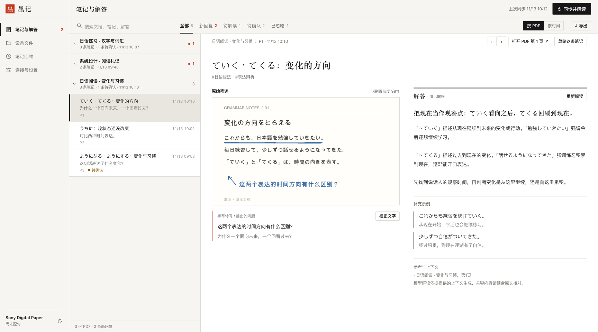
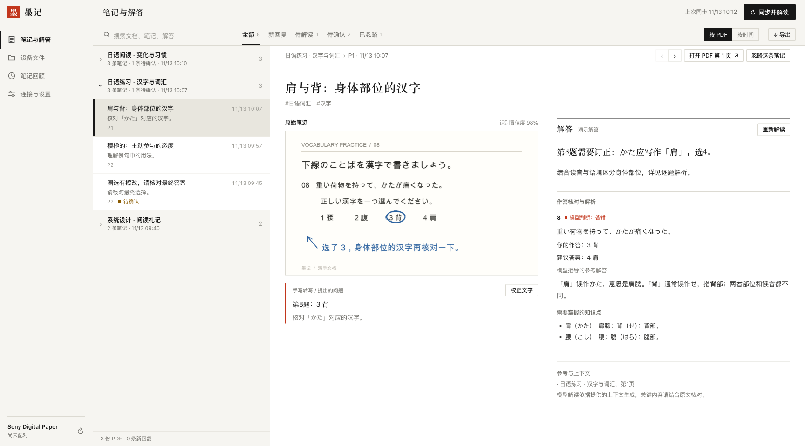
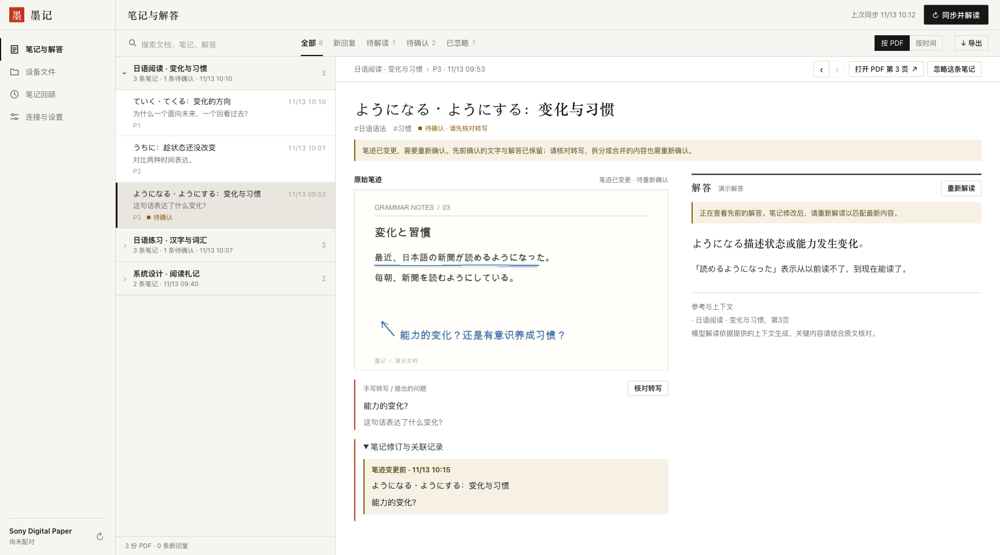

# Moji (墨记)

**A self-hosted PDF and handwritten-note companion for Sony Digital Paper.**

Sync documents and annotations from your reader, turn handwritten questions into contextual explanations, and keep the original ink, transcripts, and answer history together. Moji works with books, study materials, and everyday documents—not just exam papers.

**English** · [简体中文](README.zh-CN.md)



*The screenshots use fictional documents, simulated annotations, and sample answers. The application interface is currently in Chinese.*

## What you can do

- **Choose what to sync.** Select folders and include their subfolders. New PDFs in those folders are picked up automatically.
- **Read notes in context.** Browse by PDF or timeline, search notes and answers, and inspect the original annotation next to its transcript.
- **Keep recognition focused.** Model images isolate the current note’s strokes; a marked, annotation-free page supplies the surrounding text.
- **Review exercise answers.** Circled choices and handwritten answers can receive explanations, corrections, and relevant knowledge points. Uncertain handwriting or conflicting question claims wait for review.
- **Keep notes continuous.** Adding strokes preserves the note’s identity. Splits and merges retain history; changed, manually confirmed text requires reconfirmation instead of being overwritten.
- **Organize and archive.** Create device folders, move PDFs with backup and read-back verification, ignore notes without deleting them, and export Markdown, JSON, or a database backup.
- **Review yesterday’s learning.** Enable a daily AI summary at a configurable time (default 05:00, Asia/Shanghai). Summaries are saved in the database, available by date, and downloadable as Markdown. Automatic summaries are off by default.

## A closer look

### Exercise review

See the selected answer, the suggested answer, and the reasoning behind a correction. Model-derived answers are labeled separately from references found in the document.



### Changes that need confirmation

When handwriting changes after a transcript has been confirmed, the previous text and answer remain available. Review the new strokes before continuing; revisions remain accessible in the note.



## Run locally

Requirements: **Python 3.10+**, **Poppler** (`pdftoppm`), and a Sony Digital Paper reader for device sync. To recognize handwriting and generate answers, configure a vision-capable model with an OpenAI-compatible API. Model configuration is optional for sync and browsing.

```sh
python3 -m venv .venv
.venv/bin/python -m pip install -r app/requirements.txt
cp .env.example .env
.venv/bin/python -m app.server
```

Open **http://localhost:4387**. Configure the reader in **连接与设置** (Connection & settings), complete pairing, then refresh the device directory and select sync folders in **设备文件** (Device files).

Only selected folders are downloaded and analyzed. Existing archives remain available when a folder is removed from the sync scope.

### Try the screenshot demo

No reader, model account, or API key is required:

```sh
.venv/bin/python scripts/demo.py
```

Open **http://localhost:4391**. The demo creates three fictional PDFs and nine sample notes in `output/demo`, serves the real interface, and disables device connections, uploads, and model calls. It never loads the project’s `.env` or overwrites an existing non-demo directory.

Rendering the sample documents requires a Chinese/Japanese font. The script looks for common macOS and Noto CJK fonts; use `--font /path/to/font.ttc` if needed. Use `--data output/another-demo` to create a fresh fixture.

## Deploy to your server

The remote host needs Linux, Python 3, Docker, Docker Compose, and SSH access.

```sh
bash scripts/deploy.sh user@your-server
# Or set DPT_DEPLOY_HOST in .env:
bash scripts/deploy.sh
```

The script backs up the database before upgrading and checks service health. Open the LAN address printed after deployment. Reader address, sync folders, model endpoint, credentials, and automatic processing are configurable.

## Data and privacy

PDF snapshots, annotation previews, transcripts, and answers live on your server. Recognition and analysis send the target-note image, page context, and relevant text to the model service you configure. Review important answers against the source material.

The repository contains no preset reader IP or server address. Local `.env` files, pairing credentials, PDFs, databases, and private deployment artifacts are Git-ignored. Packaging excludes pairing keys by default; transferring them requires an explicit `--include-pairing` option.

See the [usage and deployment guide (Chinese)](docs/usage.md) for folder management, backups, note history, and the approval-based historical-repair workflow.

## Checks

```sh
.venv/bin/python -m unittest discover -s tests -p 'test_*.py' -v
node tests/test_frontend.cjs
```

## License

[MIT](LICENSE). Dependencies retain their respective licenses.
