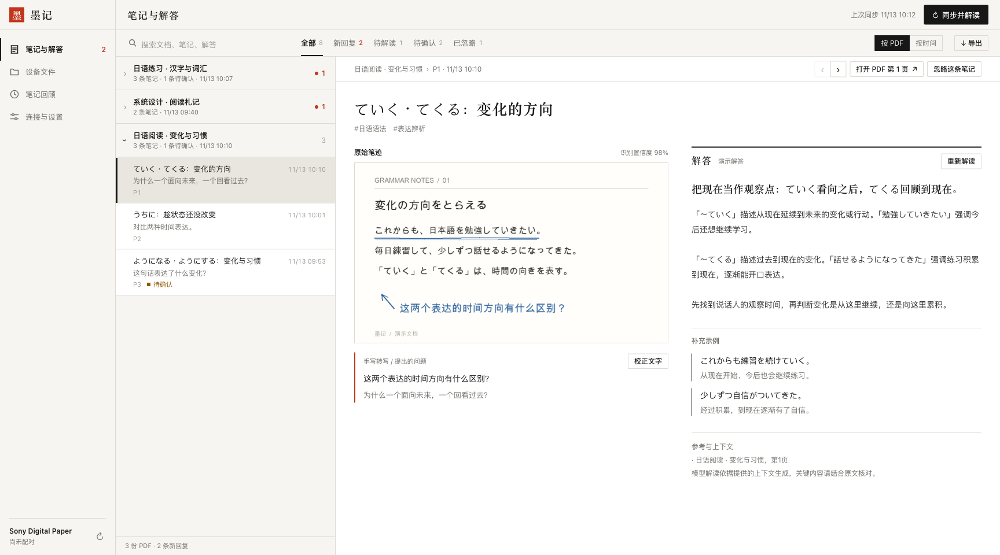
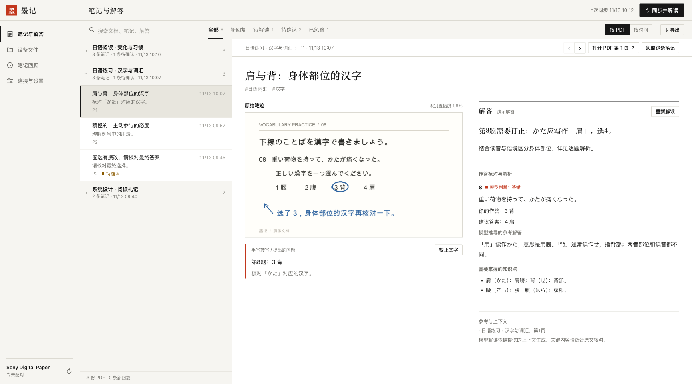
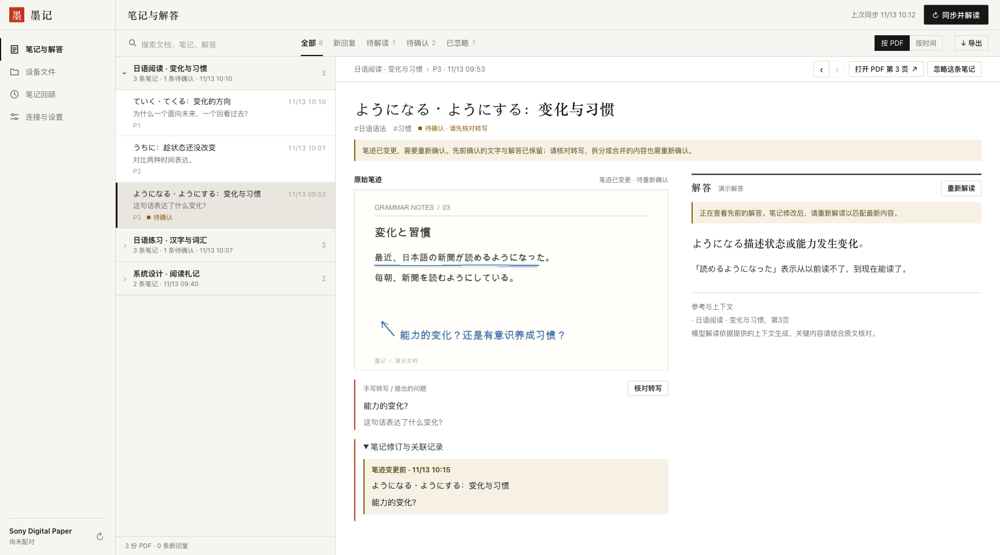

# 墨记 · Sony Digital Paper 文档与笔记助手

**自托管的 PDF 同步、手写笔记解读与归档工具。**

从阅读器同步 PDF 和批注，结合原文解答手写疑问，把原始笔迹、转写文字和解读历史保存在一起。适用于书籍、学习资料、工作文档等，不局限于考试题目。

[English](README.md) · **简体中文**



*截图使用虚构文档、模拟批注和示例解答，不包含真实用户数据。应用界面目前为中文。*

## 核心功能

- **按文件夹同步。** 选择一个或多个目录，包含其子目录；后续新放入的 PDF 也会自动加入。
- **结合原文理解笔记。** 按 PDF 或时间浏览，搜索笔记与解答，对照原始笔迹校正转写。
- **限定识别范围。** 模型截图只保留当前笔记的笔迹，另附无批注的完整页并标出目标位置，补足正文上下文。
- **核对练习作答。** 识别圈选与手写解答，提供订正、解析和知识点；笔迹不清或题目归属冲突时进入“待确认”。
- **保持笔记连续。** 补写保留笔记标识，拆分与合并记录关联；已人工确认的文字不会被新笔迹覆盖，而是等待重新确认。
- **整理与归档。** 新建设备目录，移动 PDF 前备份、移动后回读校验；忽略笔记不删除归档，支持 Markdown、JSON 导出和数据库备份。

## 界面预览

### 作答核对

同时查看圈选答案、建议答案与订正理由。模型推导与文中提供的答案依据分别标注，避免把模型判断当成标准答案。



### 笔迹变更与重新确认

确认转写后又修改笔迹时，先前的文字和解答继续保留。核对新笔迹后再继续解读，也可以展开修订记录查看之前的内容。



## 本机运行

需要 **Python 3.10+** 和 **Poppler**（`pdftoppm`）。设备同步需要 Sony Digital Paper 阅读器；识别与解答需配置支持图片输入的 OpenAI 兼容模型接口。没有配置模型时，仍可同步与浏览。

```sh
python3 -m venv .venv
.venv/bin/python -m pip install -r app/requirements.txt
cp .env.example .env
.venv/bin/python -m app.server
```

打开 **http://localhost:4387**。在“连接与设置”中配置设备并完成配对，再到“设备文件”刷新目录、选择同步文件夹。

只有所选范围会下载并进入解读。移出同步范围后，已有归档继续保留。

### 体验截图中的演示数据

不需要阅读器、模型账号或 API Key：

```sh
.venv/bin/python scripts/demo.py
```

打开 **http://localhost:4391**。演示程序在 `output/demo` 中生成 3 份虚构 PDF 和 9 条示例笔记，使用实际应用界面，禁用设备连接、上传与模型调用。不读取项目的 `.env`，也不会覆盖已有的非演示目录。

生成示例文档需要支持中日文的字体。程序会查找常见的 macOS 字体和 Noto CJK；也可用 `--font /path/to/font.ttc` 指定。用 `--data output/another-demo` 可以创建一份新的演示数据。

## 部署到服务器

远端需要 Linux、Python 3、Docker、Docker Compose 和 SSH 访问权限。

```sh
bash scripts/deploy.sh user@your-server
# 或在 .env 中设置 DPT_DEPLOY_HOST：
bash scripts/deploy.sh
```

部署前备份数据库，部署后检查服务健康状态。访问脚本输出的局域网网址即可使用。设备地址、同步文件夹、模型接口、密钥和自动处理开关均可配置。

## 数据与隐私

PDF 快照、笔迹截图、转写和解答保存在自己的服务器上。识别与解读会把目标笔迹图、页面上下文和相关文字发送给配置的模型服务；重要内容仍应结合原文核对。

源码不包含预设设备 IP 或服务器地址。`.env`、配对凭据、PDF、数据库和部署私有文件均被 Git 忽略。默认打包不复制配对密钥；迁移配对需要显式使用 `--include-pairing`，生成的私有包仅应传给自己的服务器。

完整说明见[使用与部署](docs/usage.md)，包括目录管理、备份、笔记历史，以及先审批报告再执行的历史修复流程。

## 验证

```sh
.venv/bin/python -m unittest discover -s tests -p 'test_*.py' -v
node tests/test_frontend.cjs
```

## 许可证

本项目使用 [MIT License](LICENSE)。依赖项目各自的许可证保持不变。
